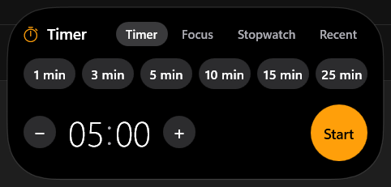
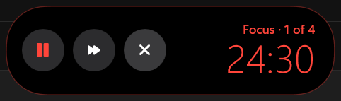
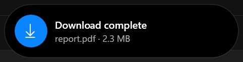
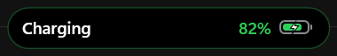
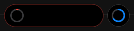

<div align="center">

# Dynamic Island for Windows

**The iPhone's Dynamic Island, rebuilt for your desktop.**

[](https://github.com/aangeraakt/DI4W/actions/workflows/build.yml)
[](https://github.com/aangeraakt/DI4W/releases/latest)
[](LICENSE)

[**Download**](https://github.com/aangeraakt/DI4W/releases/latest) · [Features](#features) · [How to use](#how-to-use) · [Island API](#island-api) · [Build](#build-from-source)

<br>


&nbsp;





&nbsp;


</div>

## Install

```
winget install aangeraakt.DynamicIsland
```

Or grab the **.msi** from the [latest release](https://github.com/aangeraakt/DI4W/releases/latest) (`win-x64`, or `win-arm64` for Snapdragon). No admin rights needed.

> Requires Windows 10 (2004+) or 11 and the [.NET 8 Desktop Runtime](https://dotnet.microsoft.com/download/dotnet/8.0). The installer tells you if it's missing.

## Features

### Live activities

| | |
|---|---|
| 🎵 **Music** | Album art, live audio bars and a seekable player |
| ⏱️ **Timer** | Countdown in the pill, big controls when expanded |
| 🍅 **Focus** | Pomodoro work and break periods with a progress ring |
| ⏲️ **Stopwatch** | Counts up to the tenth of a second |
| 💬 **Messages & calls** | Discord, WhatsApp, Telegram, Teams, Slack, Signal, Outlook |

### Add-ons

Turn each one on or off under **Settings → Add-ons**.

| | | | |
|---|---|---|---|
| 🔊 Volume | ☀️ Brightness | 🔋 Battery | 🎧 Bluetooth |
| 💾 USB drives | 📶 Wi-Fi | 🟠 Mic & camera | ⇪ Caps / Num Lock |
| 🔥 Heavy load | 📅 Calendar | 📋 Clipboard | 📸 Screenshots |
| ⬇️ Downloads | 📁 File copies | 🌙 Do Not Disturb | 🔄 Windows Update |
| ⛅ Weather | 🎮 Game mode | 🧩 Island API | |

### Built like the iPhone

- **Apple's measurements.** 126 × 37 resting island, 371-wide expanded views, squircle corners and a tinted key line.
- **Spring animations.** It bounces between sizes and squeezes when you press it.
- **Two at once.** A second activity buds off into its own bubble.
- **Stays out of the way.** It never steals focus and hides during fullscreen games and videos.
- **Lightweight.** Native C# / WPF with a WinUI 3 settings app.
- **Plus:** dark/light theme, multi-monitor, screen reader support, quiet hours, recent alerts, settings backup, auto-updates.
- **Languages:** English, Dutch, German and French.

## How to use

| Do this | To |
|---|---|
| Click the empty island | Start a timer, focus session or stopwatch |
| Click an activity | Expand it |
| Move the mouse away | Collapse it |
| Click the bubble | Swap the two activities |
| Right-click | Open the menu and settings |
| <kbd>Ctrl</kbd>+<kbd>Alt</kbd>+<kbd>I</kbd> | Hide or show the island |
| <kbd>Ctrl</kbd>+<kbd>Alt</kbd>+<kbd>O</kbd> | Open the island without a mouse |

**Music** works out of the box with Spotify. Turn on **Show any media player** for others.
**Messages** need notifications on in the app. Allow access when Windows asks.

## Island API

Show your own alerts and progress from any script on your PC.

```bash
curl -X POST http://127.0.0.1:47823/alert -d "{\"title\":\"Backup done\",\"icon\":\"success\",\"color\":\"green\"}"
curl -X POST http://127.0.0.1:47823/progress -d "{\"id\":\"backup\",\"title\":\"Backing up\",\"value\":0.4}"
```

```powershell
tools\island.ps1 -Title "Build failed" -Icon error -Button "log=Open log" -Wait
```

<details>
<summary><b>All fields</b></summary>

**`POST /alert`**

| Field | |
|---|---|
| `title` | Required, up to 120 characters |
| `message` | Second line, up to 300 characters |
| `icon` | `info` `success` `warning` `error` `download` `upload` `music` `mail` `timer` `bell` `code` `home` `star` `heart` `game` `sync` |
| `color` | `blue` `green` `orange` `red` `purple` `teal` `yellow` `indigo` `gray` or `#RRGGBB` |
| `seconds` | 1–60, default 5 |
| `sticky` | `true` keeps it open until hovered |
| `url` | `http`/`https` link opened on click |
| `buttons` | Up to two: `[{"id":"retry","label":"Retry","url":"…"}]` |

Returns `{"ok":true,"id":"…"}`. `GET /alert/<id>` returns `open`, `clicked` (with `button`) or `dismissed`.

**`POST /progress`**: `id`, `title`, `value` (0–1, leave out for busy), `detail`, `done`, `message`. Up to 5 at once.

Only local programs can connect; web pages are refused. Port and on/off under **Settings → Add-ons → Island API**.

</details>

## Build from source

Needs the [.NET 8 SDK](https://dotnet.microsoft.com/download/dotnet/8.0).

```bash
git clone https://github.com/aangeraakt/DI4W.git
cd DI4W
dotnet run --project src/DynamicIsland -c Release   # run
dotnet test tests/DynamicIsland.Tests              # test
dotnet publish src/DynamicIsland -c Release -o publish
```

<details>
<summary><b>Project structure</b></summary>

```
src/DynamicIsland/            the island (WPF)
├─ IslandWindow.xaml(.cs)     window, shape, springs, input
├─ Core/                      Activity base class, ActivityManager
├─ Activities/                Media, Timer, Focus, Stopwatch, Notifications, Api
├─ Addons/                    optional features, one switch each
├─ Settings/                  settings.json and startup
└─ UI/                        colors, fonts, icons, shapes
src/DynamicIsland.Settings/   settings app (WinUI 3)
installer/                    WiX .msi
tests/DynamicIsland.Tests/    xUnit tests
tools/                        island.ps1, release and winget scripts
```

**New activity:** subclass `Core/Activity`, provide `Leading`, `Trailing`, `Bubble` and `Expanded`, then register it in `App.xaml.cs`.

</details>

<details>
<summary><b>Publishing a release</b></summary>

```bash
powershell -ExecutionPolicy Bypass -File tools/publish-release.ps1 -Version 2.0.0
```

Builds x64 and Arm64 zips and installers, tags, publishes the GitHub release and submits to winget. Options: `-Draft`, `-NotesFile notes.md`, `-NoArm64`, `-NoWinget`. Needs the [GitHub CLI](https://cli.github.com/).

**Signing:** set `DI4W_SIGN_THUMBPRINT`, or `DI4W_TRUSTED_SIGNING_METADATA` and `DI4W_TRUSTED_SIGNING_DLIB` for [Azure Trusted Signing](https://learn.microsoft.com/azure/trusted-signing/). Without either, the build is unsigned.

</details>

## Troubleshooting

- **No music?** Use the Spotify desktop app, or turn on **Show any media player**.
- **No messages?** Allow access under **Windows Settings → Privacy & security → Notifications**.
- **Anything else?** **Settings → About → Report a problem**.

Settings live in `%AppData%\DynamicIsland\settings.json` and logs in `%AppData%\DynamicIsland\logs`.

## License

[MIT](LICENSE)
